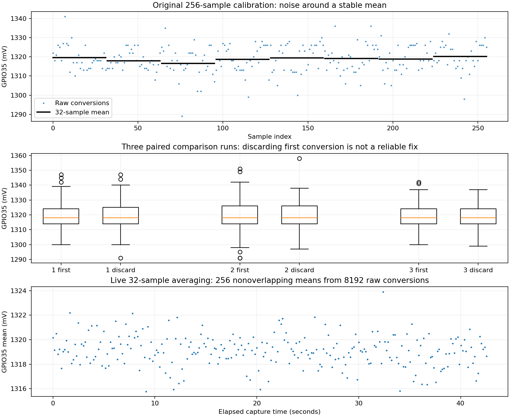

# Current ADC diagnosis — 6 October 2026

All values below are millivolts at GPIO35, with the battery/load current path confirmed disconnected and the ACS712 powered. Sample SD uses n−1; percentiles use linear interpolation. Each dataset contains 256 indexed points, and every point is supplied in its CSV. Raw calibration points are single conversions; averaged calibration points each summarize 32 nonoverlapping raw conversions.

## Acquisition and code inspection

The production sampler reads GPIO34 then GPIO35 every approximately 5 ms using analogReadMilliVolts. Calibration originally tested the min/max range of 256 individual current conversions. Telemetry instead reports the average accumulated during roughly one second. These are different statistics: a quiet reported average does not mean individual conversions are quiet. The installed ESP32 3.3.12 core calls the calibrated one-shot ADC result API once per millivolt reading. Both GPIO34/35 use ADC1 and 11 dB attenuation. Indexed sample counts and recomputed statistics match firmware diagnostics: no counter, accumulator, incomplete-run or replay bug was found.

## Raw calibration runs

| Run | Min | Max | Mean | SD | Span | Consecutive 32-sample mean span |
|---|---:|---:|---:|---:|---:|---:|
| calibration-1 | 1289.000 | 1341.000 | 1318.801 | 7.032 | 52.000 | 3.531 |
| calibration-2 | 1288.000 | 1352.000 | 1318.953 | 8.159 | 64.000 | 3.719 |
| calibration-3 | 1291.000 | 1341.000 | 1318.938 | 7.081 | 50.000 | 2.938 |

## Channel-switch comparison

For each matched trial, A reads GPIO34 then the first GPIO35 conversion. B reads GPIO34, discards the first GPIO35 conversion, then retains the next GPIO35 conversion. Order alternates AB/BA to reduce slow-drift bias. MQTT, temperature and voltage acquisition remain active. These comparisons test discarding the first conversion; they do not fully isolate all possible channel-settling or analog-circuit effects.

| Run | First span / SD | Discard-first span / SD | Mean paired difference (B−A) |
|---|---:|---:|---:|
| compare-1 | 47.000 / 7.376 | 56.000 / 7.400 | 0.430 |
| compare-2 | 60.000 / 8.118 | 61.000 / 7.378 | -0.109 |
| compare-3 | 42.000 / 6.240 | 38.000 / 6.250 | -0.805 |

Discarding the first conversion did not reliably improve the spread and was not applied as a production fix.

## Evidence-based change and live test

The data show broad sample noise with occasional extremes, not merely one isolated bad sample. Short consecutive block means remain stable; the original three run means differ by only about 0.15 mV. The evidence favors sample noise rather than sustained zero drift over the observed intervals. It does not identify the physical source as ADC, sensor, supply or wiring noise.

An explicit opt-in CALIBRATE_CURRENT_AVERAGED DISCONNECTED command estimates the zero using 256 nonoverlapping 32-sample means (8192 underlying readings, about 43 seconds). Original raw calibration remains unchanged under CALIBRATE_CURRENT DISCONNECTED. The numeric 100/3000 mV mean limits and 30 mV point-span limit were not widened. In the new mode the 30 mV limit applies to block means, not raw conversions; this is an explicit change of estimator, not proof the raw ADC became quiet. Any raw reading at <=100 or >=3100 mV rejects the averaged run. Raw noise remains visible and sets the minimum current delta to max(10 mV, twice the full raw span), preserving conservative unavailability for small currents. Runtime current already uses one-second averages, so offset estimation now matches the averaged signal rather than rejecting a stable mean solely on individual conversion extremes.

Espressif documents multisampling as an ADC noise mitigation: [ESP32 ADC noise guidance](https://docs.espressif.com/projects/esp-idf/en/v4.4.1/esp32/api-reference/peripherals/adc.html). Hardware filtering is a separate possible next experiment, not something tested here.

| Averaged run | Min | Max | Mean | SD | Point span |
|---|---:|---:|---:|---:|---:|
| averaged-1 | 1315.781 | 1323.906 | 1319.092 | 1.271 | 8.125 |

The first live averaged run completed in 42720 ms, used 8192 raw readings, had raw SD 6.714 mV and raw span 64 mV, no rail readings, and retained a 128 mV current floor. It accepted a session-only averaged zero of 1319.092 mV; subsequent current stayed null/below_resolution. MQTT published during the capture, with voltage and temperature still working. This demonstrates stable averaged zero estimation, not accurate current or gain calibration. A requested repeat was initially blocked when COM5 disappeared; that is an external device-connection change, not a calibration rejection.

## Percentiles and consecutive block averages

### averaged-1: calibration

| Percentile | P1 | P5 | P25 | P50 | P75 | P95 | P99 |
|---|---:|---:|---:|---:|---:|---:|---:|
| mV | 1315.938 | 1316.742 | 1318.375 | 1319.125 | 1319.812 | 1321.258 | 1321.984 |

Consecutive means of points 0–31, 32–63, …, 224–255: 1319.373, 1319.378, 1319.082, 1318.844, 1319.316, 1319.037, 1318.919, 1318.786 mV.

Captured 256 points; point timestamp span 42531 ms; maximum point gap 233 ms. Underlying raw gaps and block-point gaps are different for averaged captures.

[Complete CSV](evidence/adc/averaged-1.csv) · [Statistics JSON](evidence/adc/averaged-1.json) · [Serial log](evidence/adc/averaged-1.log)

### calibration-1: calibration

| Percentile | P1 | P5 | P25 | P50 | P75 | P95 | P99 |
|---|---:|---:|---:|---:|---:|---:|---:|
| mV | 1299.550 | 1307.750 | 1314.000 | 1318.000 | 1325.000 | 1328.000 | 1335.450 |

Consecutive means of points 0–31, 32–63, …, 224–255: 1319.562, 1317.969, 1316.625, 1318.656, 1319.438, 1319.156, 1318.844, 1320.156 mV.

Captured 256 points; point timestamp span 1374 ms; maximum point gap 43 ms. Underlying raw gaps and block-point gaps are different for averaged captures.

[Complete CSV](evidence/adc/calibration-1.csv) · [Statistics JSON](evidence/adc/calibration-1.json) · [Serial log](evidence/adc/calibration-1.log)

### calibration-2: calibration

| Percentile | P1 | P5 | P25 | P50 | P75 | P95 | P99 |
|---|---:|---:|---:|---:|---:|---:|---:|
| mV | 1294.850 | 1306.750 | 1314.000 | 1318.000 | 1325.000 | 1329.000 | 1341.000 |

Consecutive means of points 0–31, 32–63, …, 224–255: 1320.500, 1318.312, 1319.969, 1316.781, 1319.594, 1317.938, 1318.781, 1319.750 mV.

Captured 256 points; point timestamp span 1370 ms; maximum point gap 36 ms. Underlying raw gaps and block-point gaps are different for averaged captures.

[Complete CSV](evidence/adc/calibration-2.csv) · [Statistics JSON](evidence/adc/calibration-2.json) · [Serial log](evidence/adc/calibration-2.log)

### calibration-3: calibration

| Percentile | P1 | P5 | P25 | P50 | P75 | P95 | P99 |
|---|---:|---:|---:|---:|---:|---:|---:|
| mV | 1301.100 | 1308.000 | 1314.750 | 1318.000 | 1325.000 | 1329.250 | 1334.000 |

Consecutive means of points 0–31, 32–63, …, 224–255: 1320.031, 1319.625, 1319.562, 1318.656, 1318.906, 1317.656, 1319.969, 1317.094 mV.

Captured 256 points; point timestamp span 1367 ms; maximum point gap 35 ms. Underlying raw gaps and block-point gaps are different for averaged captures.

[Complete CSV](evidence/adc/calibration-3.csv) · [Statistics JSON](evidence/adc/calibration-3.json) · [Serial log](evidence/adc/calibration-3.log)

### compare-1: first_conversion

| Percentile | P1 | P5 | P25 | P50 | P75 | P95 | P99 |
|---|---:|---:|---:|---:|---:|---:|---:|
| mV | 1300.000 | 1307.000 | 1314.000 | 1318.000 | 1324.000 | 1330.000 | 1340.350 |

Consecutive means of points 0–31, 32–63, …, 224–255: 1317.312, 1320.625, 1319.812, 1321.250, 1316.594, 1320.875, 1317.219, 1317.656 mV.

Captured 256 points; point timestamp span 1315 ms; maximum point gap 21 ms. Underlying raw gaps and block-point gaps are different for averaged captures.

[Complete CSV](evidence/adc/compare-1.csv) · [Statistics JSON](evidence/adc/compare-1.json) · [Serial log](evidence/adc/compare-1.log)

### compare-1: discard_first_conversion

| Percentile | P1 | P5 | P25 | P50 | P75 | P95 | P99 |
|---|---:|---:|---:|---:|---:|---:|---:|
| mV | 1300.550 | 1307.750 | 1314.000 | 1318.000 | 1325.000 | 1330.000 | 1338.350 |

Consecutive means of points 0–31, 32–63, …, 224–255: 1317.625, 1320.969, 1318.125, 1321.844, 1316.531, 1319.938, 1320.250, 1319.500 mV.

Captured 256 points; point timestamp span 1315 ms; maximum point gap 21 ms. Underlying raw gaps and block-point gaps are different for averaged captures.

[Complete CSV](evidence/adc/compare-1.csv) · [Statistics JSON](evidence/adc/compare-1.json) · [Serial log](evidence/adc/compare-1.log)

### compare-2: first_conversion

| Percentile | P1 | P5 | P25 | P50 | P75 | P95 | P99 |
|---|---:|---:|---:|---:|---:|---:|---:|
| mV | 1296.650 | 1309.000 | 1314.000 | 1318.000 | 1326.000 | 1331.500 | 1340.350 |

Consecutive means of points 0–31, 32–63, …, 224–255: 1319.031, 1320.438, 1320.062, 1320.469, 1320.531, 1318.219, 1319.000, 1316.906 mV.

Captured 256 points; point timestamp span 1318 ms; maximum point gap 35 ms. Underlying raw gaps and block-point gaps are different for averaged captures.

[Complete CSV](evidence/adc/compare-2.csv) · [Statistics JSON](evidence/adc/compare-2.json) · [Serial log](evidence/adc/compare-2.log)

### compare-2: discard_first_conversion

| Percentile | P1 | P5 | P25 | P50 | P75 | P95 | P99 |
|---|---:|---:|---:|---:|---:|---:|---:|
| mV | 1303.550 | 1308.000 | 1314.000 | 1318.000 | 1326.000 | 1330.000 | 1337.000 |

Consecutive means of points 0–31, 32–63, …, 224–255: 1318.656, 1321.188, 1319.531, 1319.562, 1320.875, 1318.969, 1315.969, 1319.031 mV.

Captured 256 points; point timestamp span 1318 ms; maximum point gap 35 ms. Underlying raw gaps and block-point gaps are different for averaged captures.

[Complete CSV](evidence/adc/compare-2.csv) · [Statistics JSON](evidence/adc/compare-2.json) · [Serial log](evidence/adc/compare-2.log)

### compare-3: first_conversion

| Percentile | P1 | P5 | P25 | P50 | P75 | P95 | P99 |
|---|---:|---:|---:|---:|---:|---:|---:|
| mV | 1302.550 | 1310.000 | 1314.000 | 1318.000 | 1324.000 | 1328.000 | 1333.700 |

Consecutive means of points 0–31, 32–63, …, 224–255: 1317.062, 1318.781, 1321.594, 1320.312, 1316.875, 1319.969, 1320.719, 1318.344 mV.

Captured 256 points; point timestamp span 1317 ms; maximum point gap 35 ms. Underlying raw gaps and block-point gaps are different for averaged captures.

[Complete CSV](evidence/adc/compare-3.csv) · [Statistics JSON](evidence/adc/compare-3.json) · [Serial log](evidence/adc/compare-3.log)

### compare-3: discard_first_conversion

| Percentile | P1 | P5 | P25 | P50 | P75 | P95 | P99 |
|---|---:|---:|---:|---:|---:|---:|---:|
| mV | 1302.000 | 1308.750 | 1314.000 | 1318.000 | 1324.000 | 1327.000 | 1330.450 |

Consecutive means of points 0–31, 32–63, …, 224–255: 1315.844, 1318.938, 1319.219, 1319.375, 1316.094, 1321.000, 1319.125, 1317.625 mV.

Captured 256 points; point timestamp span 1317 ms; maximum point gap 35 ms. Underlying raw gaps and block-point gaps are different for averaged captures.

[Complete CSV](evidence/adc/compare-3.csv) · [Statistics JSON](evidence/adc/compare-3.json) · [Serial log](evidence/adc/compare-3.log)

## Limits

No accurate small-current measurement, gain/sensitivity verification, LED-current detection, power or energy measurement is claimed. Current floor is deliberately conservative and is a software noise guard, not a measured accuracy specification. Calibration is operator-triggered only with a disconnected path, held in RAM, and lost on reboot. No baseline is hardcoded. No deliberate hardware filtering, sensor rewiring, external reference voltage or known-current bench measurement was performed.

